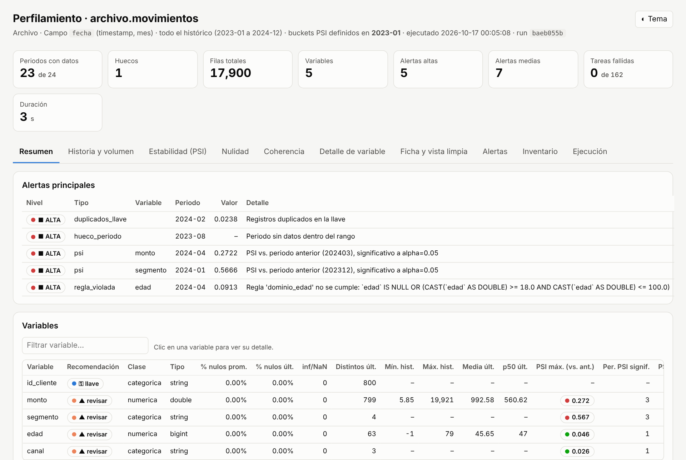
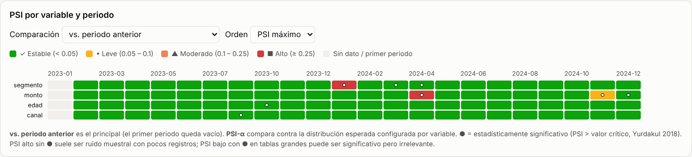
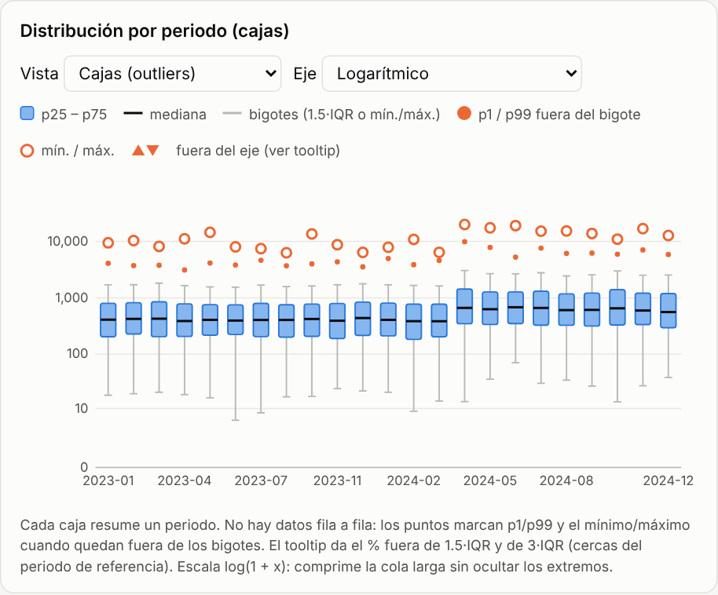

# perfilador-datos

**Perfilamiento y validación de calidad de archivos tabulares** (`.csv`, `.txt`, `.xlsx`, `.xlsm`) con un reporte
HTML interactivo de un solo archivo. Responde, antes de usar un archivo para análisis o modelos: ¿qué historia tiene,
llega completo cada periodo, qué tan estable es cada variable y hay datos incoherentes?

[English below](#english)



## Qué revisa

| Área | Qué mide |
|---|---|
| **Lectura** | Codificación, separador y coma decimal detectados; filas/columnas vacías, encabezados vacíos o duplicados, filas de totales (se excluyen), filas duplicadas. Todo se lee como texto y el tipo se **infiere y se explica** (los códigos con ceros a la izquierda no se corrompen; reconoce `$1,234`, `dd/mm/aaaa`, `mm/aaaa`, `aaaa-mm`). |
| **Historia** | Filas por periodo, **huecos**, variación contra el periodo anterior, volumen atípico (z robusto con MAD), último periodo parcial. |
| **Por variable y periodo** | n, nulos y % nulos, inf/NaN, ceros, negativos, vacíos, distintos, mín./máx., media, std, mediana, percentiles p1–p99, longitudes de texto. |
| **Estabilidad** | **PSI contra el periodo anterior** (principal) y contra el periodo de referencia, con **valor crítico chi²** (Yurdakul 2018) para separar cambios reales de ruido muestral. **PSI-α** contra una distribución esperada que tú defines por variable. |
| **Coherencia** | Outliers (cercas de Tukey 1.5·IQR y 3·IQR), asimetría y curtosis, valores centinela (−1, 999999, 19000101…), nulos disfrazados (`N/A`, `NULL`, `-`…), espacios y categorías que solo difieren en mayúsculas, números o fechas guardados como texto, fechas futuras/antiguas/por defecto, IDs disfrazados, códigos enteros que son categorías, categorías nuevas y raras, columnas idénticas, cambio de régimen. |
| **Reglas de negocio** | Dominios (`edad: 18–100`) y reglas entre campos en SQL (`saldo <= limite`). |
| **Llave** | Duplicados por periodo y cobertura entre periodos (¿es un panel o cada entidad aparece una vez?). |
| **Ficha** | Recomendación *sugerida* por variable (usar / revisar / excluir) y una **vista limpia en SQL** que solo corrige errores de dato evidentes. |

**Lo que no hace, a propósito:** no imputa, no recorta outliers, no escala ni reduce dimensiones. Mide y sugiere;
esas decisiones son de quien modela.

## Instalación

Requiere Python ≥ 3.8 con `pandas`, `numpy` y `openpyxl` (para Excel). `scipy` es opcional.

```bash
pip install git+https://github.com/xavierp26/perfilador-datos.git
# o, desde una copia local:
pip install -e .
```

También funciona sin instalar: `python perfilar_archivo.py ...` desde la carpeta del repo.

## Uso

**Línea de comandos**

```bash
perfilador ejemplos/movimientos.csv --fecha fecha --llave id_cliente --dominio edad:18:100 --regla "monto > 0"
perfilador catalogo.xlsx --llave categoria_id          # sin --fecha: "foto única" (catálogos)
perfilador ventas.csv --fecha fecha --granularidad anio
```

| Opción | Para qué |
|---|---|
| `--fecha` | columna de periodo (sin ella el archivo se mide como una sola foto) |
| `--llave` | columna(s) que deberían ser únicas por periodo, separadas por coma |
| `--granularidad` | `anio`, `mes` (por defecto) o `dia` |
| `--hoja` | hoja de Excel (por defecto la primera visible) |
| `--dominio var:min:max` | rango válido (repetible) |
| `--regla "expr SQL"` | condición que debe cumplirse en cada fila (repetible) |
| `--sep`, `--decimal` | solo si la detección automática falla |
| `--salida`, `--no-abrir` | carpeta de salida; no abrir el reporte al terminar |

En Windows también puedes arrastrar el archivo encima de `perfilar_archivo.bat`.

**Python / Jupyter**

```python
from perfilador import perfilar_archivo, asistente

perf = perfilar_archivo("movimientos.csv", campo_fecha="fecha", llave="id_cliente",
                        reglas_dominio={"edad": {"min": 18, "max": 100}},
                        reglas={"monto_positivo": "monto > 0"})
perf.mostrar()                 # reporte embebido en el notebook
perf.resultado["alertas"]      # DataFrame con todas las alertas

perf = asistente()             # interactivo: pregunta ruta, campo fecha, granularidad, llave y reglas
```

## Salida

`perfilador_salidas/<archivo>/<run_key>/`:

- `perfil_*.html` — reporte interactivo autocontenido (sin internet ni CDNs; se puede mandar por correo). Tema claro/oscuro.
- `perfil_*.xlsx` — todas las tablas: alertas, ficha, estadísticos, PSI, buckets, coherencia…
- `vista_limpia_*.sql` — propuesta de vista corregida, para revisar.
- `estado.json`, `perfilador.log`, `tareas/` — trazabilidad y checkpoints.

**Reanudable:** el `run_key` sale de los parámetros y de la huella del archivo. Si se interrumpe, correr lo mismo
retoma solo lo pendiente; si el archivo cambia, se recalcula.

| | |
|---|---|
|  |  |

## Configuración

Umbrales, reglas, nulos disfrazados y distribuciones esperadas en `src/perfilador/static/config.json`, o por parámetro:

```python
perfilar_archivo(..., umbrales={"psi_moderado": 0.1, "psi_alto": 0.25, "alpha": 0.01, "psi_min_n": 300},
                 psi_esperado={"monto": {"cortes": [200, 400, 800], "esperado": [.25, .25, .25, .25]},
                               "segmento": {"categorias": {"A": .4, "B": .3}, "otros": .3}})
```

## Cómo funciona

1. El archivo se lee como texto, se infieren los tipos y se carga en **SQLite en memoria** (librería estándar).
2. Las métricas se calculan con **SQL agregado** por periodo y por lote de variables (`sql.py`, dialecto estilo
   Impala/Hive traducido a SQLite con funciones registradas en Python: `NDV`, `APPX_MEDIAN`, `is_inf`…). Percentiles
   con `NTILE(100)`. Solo se traen a pandas los agregados.
3. Cada tarea (fase × periodo × lote) es independiente y deja un checkpoint: si una falla, se registra y se sigue.
4. pandas consolida: PSI y su valor crítico, forma de la distribución, coherencia, alertas agrupadas y ficha.
5. El reporte es una plantilla HTML con JavaScript y SVG propios, sin librerías externas.

**Leer el PSI:** < 0.10 estable · 0.10–0.25 moderado · ≥ 0.25 alto. Solo alerta si además es estadísticamente
significativo y ambos periodos tienen ≥ 100 filas: con pocos registros un PSI alto puede ser ruido; con millones casi
todo es "significativo" y manda el umbral. El aporte de cada bucket es `(a − e)·ln(a/e)`, así que una categoría chica
que se triplica pesa más que una grande que baja unos puntos.

**Limitaciones:** el archivo se carga en memoria (millones de filas funcionan pero lento); `NDV` y la mediana son
exactos en SQLite; SQLite guarda NaN como NULL; el boxplot sale de percentiles agregados, no de filas individuales.

## Pruebas

```bash
python tests/test_perfilador.py      # o: python -m pytest -q
```

Generan archivos sintéticos con problemas sembrados (hueco, drift, categoría nueva, centinelas, nulos disfrazados,
duplicados, CSV con `;`/coma decimal/latin-1/fila de totales, fechas `mm/aaaa`, montos con `$`) y verifican que se
detecten, incluida la reanudación.

---

## English

**Data profiling and quality validation for tabular files** (`.csv`, `.txt`, `.xlsx`, `.xlsm`), producing a single
self-contained interactive HTML report plus an Excel workbook. The code, messages and report are in Spanish.

**What it checks:** robust file reading with explained type inference (leading zeros preserved; detects encoding,
separator, decimal comma, currency and several date formats); per-period history, gaps and volume anomalies (robust
z-score / MAD); per-variable completeness and distribution statistics (p1–p99 via `NTILE`); **PSI against the
previous period** with a chi-square critical value (Yurdakul 2018) so small-sample noise is not flagged, plus
**PSI-α** against a user-defined expected distribution; coherence checks (Tukey fences, skew/kurtosis, sentinel
values, disguised nulls, whitespace/case collisions, numbers or dates stored as text, future/default dates, hidden IDs,
integer codes that are categories, new/rare categories, identical columns, regime changes); domain and cross-field SQL
rules; key duplicates and panel coverage; a per-variable recommendation and a suggested "clean view" in SQL.
It deliberately does **not** impute, clip, scale or reduce dimensions.

**Install:** `pip install git+https://github.com/xavierp26/perfilador-datos.git` (Python ≥ 3.8, pandas, numpy,
openpyxl; scipy optional).

**Use:**

```bash
perfilador data.csv --fecha date_column --llave id --granularidad mes   # mes = month, anio = year, dia = day
```

```python
from perfilador import perfilar_archivo
perf = perfilar_archivo("data.csv", campo_fecha="date_column", llave="id")
```

**How it works:** the file is loaded into in-memory SQLite; metrics are computed with aggregated SQL per period and
per batch of variables (an Impala/Hive-style dialect translated to SQLite with Python-registered functions); only
aggregates reach pandas. Each task is checkpointed, so runs are resumable and a failing task does not stop the rest.
The report is plain HTML/JS/SVG with no external dependencies.

**Tests:** `python tests/test_perfilador.py` generates synthetic files with seeded problems and checks they are found.

## Licencia / License

MIT
